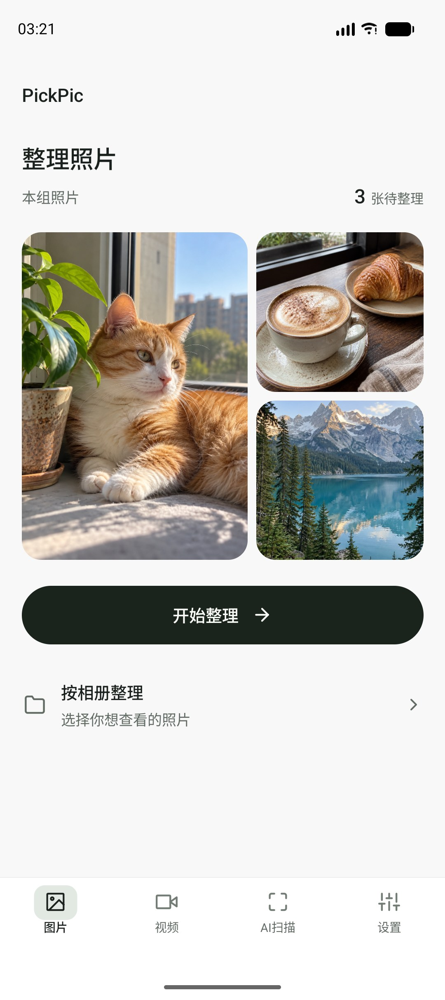
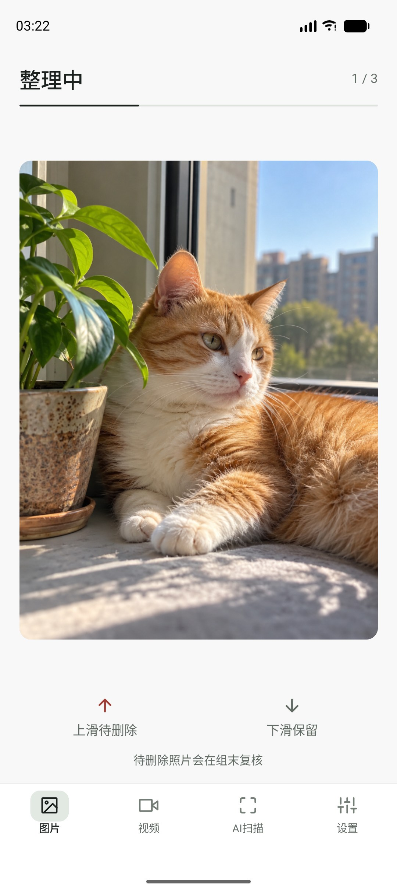
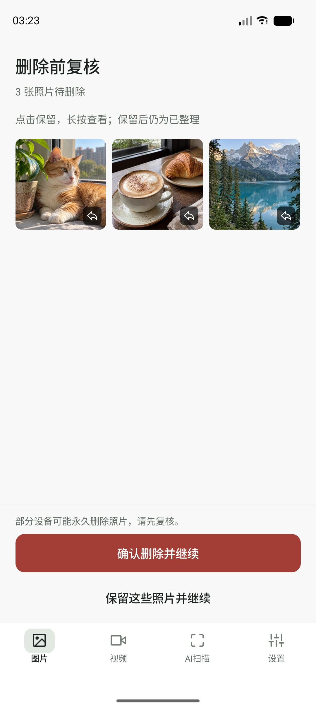
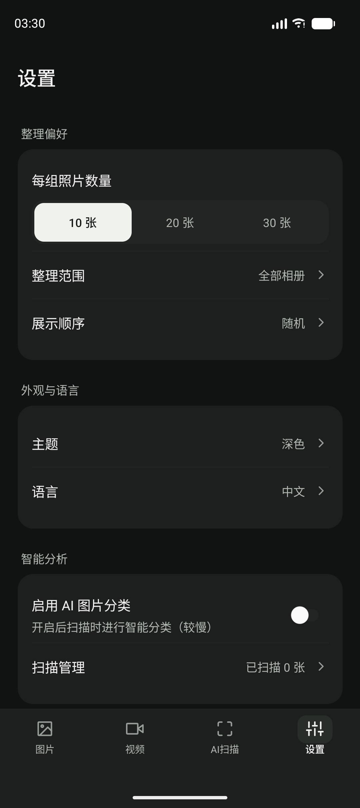

[简体中文](README.md) | English

# PickPic

PickPic is an offline-first local photo and video organizer. Review media one item at a time, decide whether to keep, skip, or queue items for deletion, and securely track your progress locally on-device. It supports light, dark, and system-following themes along with on-device blur detection, similar-photo comparison, and optional image classification.

Current public release: **0.5.0**, focused on Android; native iOS support is still in progress. See the [Documentation Index](docs/README.md) and [Encrypted Backup & SDK Patches](docs/ENCRYPTED_BACKUP.md) for architecture details.

## Download (0.5.0 Release)

Download the [0.5.0 Android APK](https://github.com/1Beyond1/PickPic/releases/download/v0.5.0/PickPic-v0.5.0-arm64.apk), or view the [full release notes and checksums](https://github.com/1Beyond1/PickPic/releases/tag/v0.5.0). The package targets **Android 10+ (ARM64 / `arm64-v8a`)** with bundled runtime assets and requires neither Expo Go nor a dev server. See [GitHub Releases](https://github.com/1Beyond1/PickPic/releases) for other releases.

**Upgrading from older builds**: `0.5.0` uses the same release signing key introduced in `0.4.0`, so `0.4.0` users can upgrade directly in place and automatically migrate local records into encrypted storage. Builds from `0.3.1` or earlier used a debug key and require uninstalling first (uninstalling clears in-app history, scan records, and preferences without deleting original photos or videos).

## Screenshots

<p align="center">
  <a href="assets/screenshots/photo-home.jpg"></a>
  &nbsp;&nbsp;
  <a href="assets/screenshots/photo-organizer.jpg"></a>
</p>

<p align="center">
  <a href="assets/screenshots/photo-review.jpg"></a>
  &nbsp;&nbsp;
  <a href="assets/screenshots/settings-dark.jpg"></a>
</p>

## Key Features

### Photo & Video Organizing

- **Card-based photo organizing**: Process photos in batches of 10 / 20 / 30. Swipe up to queue for deletion or swipe down to keep; swiping up never immediately deletes the original file.
- **Vertical video feed**: Swipe up/down through videos with side controls for mute, favorite, share, keep, and queue for deletion. Simply opening or leaving the video tab does not mark videos as organized; supports revisiting organized videos and long-press fullscreen playback.
- **Resumable sessions, temporary skip & recent decisions**: Photo and video sessions persist scope and position across restarts. Temporarily skip items to revisit later, and undo up to 100 recent local decisions.
- **Multi-dimensional scope filters & quick presets**: Combine album, calendar month, and newest / oldest / random ordering. Includes one-tap quick presets for **Old Screenshots (30+ / 90+ days)** and Android **Large Videos**, while the custom native module `PickPicMediaIndex` reads the Android `MediaStore` size column to enable **Largest First** sorting.
- **Unified pending-deletion review**: Photos, videos, and on-device analysis results feed into one shared review screen with type/source filters. Tapping a thumbnail opens preview; a dedicated **Keep** action removes an item from the queue while keeping it marked organized. System deletion runs only after confirmation.

### On-Device Analysis & Similar Photo Comparison

- **100% local processing**: Blur estimation (Laplacian variance / mean luma), 64-bit perceptual hashing (dHash), and time-windowed similarity grouping run entirely on-device—no cloud AI uploads and no automatic deletions.
- **Batched single-transaction library sync**: Scanner synchronization reads existing rows per page (100 items), skips expensive `FileSystem.getInfoAsync` checks for valid unchanged assets, stats new/changed items with bounded concurrency (max 16), and commits each page in a single SQLCipher transaction with cooperative pause/stop support. High-resolution photos are downscaled before face detection with immediate temporary file cleanup.
- **Side-by-side & A/B similar-photo comparison**: Compare similar shots side-by-side or A/B with synchronized zoom and metadata inspection. Mark one or more photos to keep, queue the rest for deletion, and complete the group; keep recommendations are scored by resolution, sharpness, and brightness. Mark false positives as **"Not Similar"** from cards, group detail, or comparison view—stable keys persist across both SQLCipher and AES-256-GCM storage and restore via v2 encrypted backups so ignored groups do not resurface after rescans or device switches.
- **Byte-identical Exact Duplicate detection**: Separate **Exact** tab on Scan Results (strictly distinct from perceptual dHash similarity): buckets scanned photos by exact `fileSize` first and runs bounded-concurrency SHA-256 hashing only on multi-file size buckets under a 32 MiB per-file cap, 16 MiB global in-flight byte budget, and serial degradation for large files (≥ 8 MiB), explicitly reporting unknown-size (native size index is Android-only for now), oversized, or unreadable/permission-skipped items. Honors Protected Albums rules, supports `ZoomablePhotoModal` preview and one-tap "Protected / Earliest first" queuing into unified pending-deletion review without direct deletion.
- **Optional image labeling & face detection**: Disabled by default; toggle in **Settings → AI Analysis**. Uses bundled `EfficientNet-Lite4` (TFLite) for labeling and ML Kit for face detection. Supports on-demand AI backfill and error retry in **Scan Management** while preserving existing blur and similarity results; enabling the toggle does not auto-start a scan.

### Local Encryption, Encrypted Backup & Privacy

- **Fail-closed local encryption, 3-layer Protected Albums & domain self-rescue**: Organizing decisions, pending-deletion/favorite queues, sessions, and settings are persisted with authenticated AES-256-GCM encryption; the scanner database uses SQLCipher; per-domain random device keys are stored in `expo-secure-store` (Android Keystore / iOS Keychain). Protected Albums enforce a 3-layer guard (skipped by default during unfiltered organizing, blocked across all deletion queue entry points, and re-verified fail-closed right before OS deletion). Keystore, SQLCipher decrypt, or Schema failures open a domain-specific self-rescue wizard supporting verify-before-restore `.pickpic` recovery or draining all write queues before resetting only the local privacy index (never touching original media).
- **Passphrase-encrypted backup & restore (v2)**: Export and restore organizing decisions, favorites, pending queues, Protected Albums, and review ignores (blur ignores and device-independent **"Not Similar"** keys; backward-compatible with v1 imports; excludes original media, thumbnails, EXIF, and location) under **Settings → Data Management**. Supports up to **32 MiB** ciphertext payload, native async `scrypt` (`N=65536, r=8, p=2`) via `react-native-quick-crypto`, AES-256-GCM, unique 1-to-1 cross-device content-fingerprint rebinding, pre-restore preview, and conflict protection.
- **Cache & OS backup boundaries**: Never requests media location access (`isAccessMediaLocationEnabled: false`); gallery previews use memory-only caching; startup and scanner runs clean app-owned temporary image caches with a fail-closed cache gate; Android/iOS config plugins exclude app private data from automatic OS/cloud backups.
- **SDK privacy log redaction patches**: `scripts/apply-privacy-patches.js` applies version- and SHA-256-verified log redactions across **14 files** in ML Kit (Android Kotlin, iOS Swift, and JS/TS) and `expo-media-library`, paired with `scripts/check-privacy-config.mjs` static config checks while Android autolinking forces `expo-media-library` and `expo-image` to build from source so prebuilt artifacts cannot bypass patches.

See [ENCRYPTED_BACKUP.md](docs/ENCRYPTED_BACKUP.md) for encryption and backup design details.

## Deletion & Cloud Sync Warnings

**Back up important photos and videos before deleting.** PickPic's pending-deletion list is an in-app confirmation queue, not a system recycle bin for recovering deleted files.

- Current system deletion APIs do not guarantee items move to a trash bin. On Android 11+, `MediaStore.createDeleteRequest` requests permanent deletion directly rather than moving files to trash. See the [Android media storage guide](https://developer.android.com/training/data-storage/shared/media#manage-groups-media-files).
- On Android 11 (API 30) and above, large deletion requests are uniformly split into batches of up to **1,000 items** to avoid Binder `TransactionTooLargeException`, which may prompt multiple OS confirmations. Completed batches are settled immediately; cancelling or failing a later batch leaves remaining items in the pending queue.
- PickPic does not manage cloud backups and cannot guarantee "delete locally only, keep in cloud." Services such as iCloud Photos may sync deletions across your account and other devices. See [Apple Support](https://support.apple.com/en-nz/104967).

## Architecture & Tech Stack

- **Framework & UI**: React Native `0.81.5` (New Architecture + React Compiler), Expo SDK `54`, TypeScript `~5.9`, Expo Router `~6.0`, Zustand `^5.0`, Reanimated `~4.1`, Gesture Handler, `expo-media-library`, `expo-video`, `expo-image`.
- **Local Security & Cryptography**: `expo-sqlite` (SQLCipher), `expo-secure-store`, `@noble/ciphers`, `@noble/hashes`, `react-native-quick-crypto` (Nitro native async `scrypt`).
- **On-Device Vision & ML**: `@infinitered/react-native-mlkit-core` / `image-labeling` / `face-detection` (`5.0.0`), bundled `assets/ml/efficientnet-lite4.tflite`, `expo-image-manipulator`, `jpeg-js`.
- **Custom Native Modules & Config Plugins**:
  - `modules/pickpic-media-index`: Android Kotlin read-only `MediaStore` batch size reader (≤ 200 IDs/batch).
  - `modules/pickpic-system-ui`: Android Kotlin module to sync active RN modal status/navigation bar appearance in place.
  - `plugins/withNativeCryptoToolchain.js` & `plugins/withPrivateRecordsBackup.js`: Gradle/NDK toolchain alignment and Android/iOS private-data backup exclusion rules.

## Running from Source & Verification

### Prerequisites

- Node.js `20.19.4+` and npm (**Node.js `24.11.1`** is used in CI and recommended for the full test suite).
- Android local development: JDK 17, Android SDK, and an emulator or physical device.
- iOS local development: macOS and Xcode.

```bash
git clone https://github.com/1Beyond1/PickPic.git
cd PickPic
npm ci

# First build and install of the Android development client
npm run android

# Subsequent dev server launches for the installed dev client
npx expo start --dev-client
```

Because PickPic bundles ML Kit, SQLCipher, Quick Crypto, and custom Kotlin modules, the full app cannot run in Expo Go. Rebuild the development client whenever native dependencies change; JS/TS edits reload via Metro. See [Expo Development Builds](https://docs.expo.dev/workflow/customizing/).

`npm ci` runs `scripts/apply-privacy-patches.js` via `postinstall`. In environments with npm lifecycle scripts disabled, run the patch script and verify with `--check` before building; never skip verification.

### Checks & Builds

```bash
# Five required checks matching CI (.github/workflows/ci.yml)
node scripts/apply-privacy-patches.js --check
node scripts/check-privacy-config.mjs
npm run typecheck
npm run lint
npm run test:ci

# EAS cloud preview APK (requires Expo account & project access)
npx eas-cli build -p android --profile preview

# Local EAS preview APK on macOS / Linux (native Windows is not supported by EAS --local)
npx eas-cli build -p android --profile preview --local
```

### Automated Test Coverage

The repository includes **98 test suites / 963 tests** (covering in-memory SQLite transactions, AES-256-GCM / `scrypt` crypto, v2 cross-device recovery and fail-closed privacy gates, Protected Albums and exact duplicate detection, quick presets and "Not Similar" persistence, batched scanner sync with bounded concurrency, static privacy config gates, and SDK privacy patch fingerprints), enforced in CI alongside TypeScript typecheck, ESLint, and `--check` patch validation. See [REAL_DEVICE_CHECKLIST.md](docs/REAL_DEVICE_CHECKLIST.md) for physical-device test items.

## Feedback & Contributing

- Contributors should read [AGENTS.md](AGENTS.md) and [docs/README.md](docs/README.md) first.
- When reporting issues on [GitHub Issues](https://github.com/1Beyond1/PickPic/issues), include app version, device model, OS version, and reproduction steps.
- Run all five checks above before committing, and avoid committing signing keystores, `build-artifacts/`, or `*.pickpic` backups.

## License

Original source code is licensed under the [Apache License 2.0](LICENSE); see [NOTICE](NOTICE) for attribution details. Third-party dependencies and bundled models retain their respective licenses.
