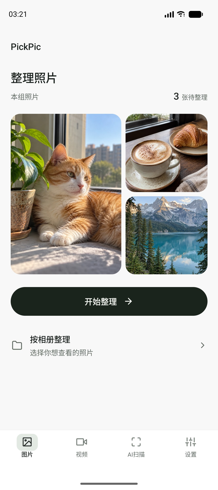
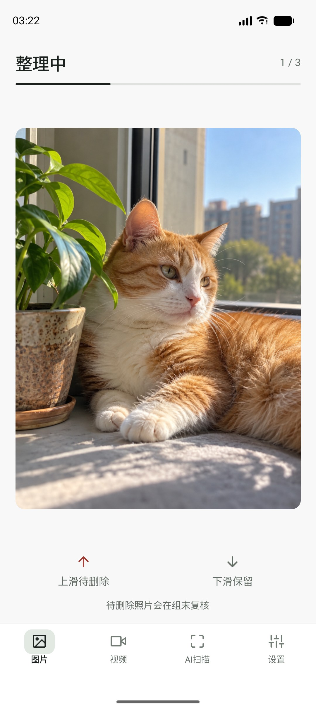
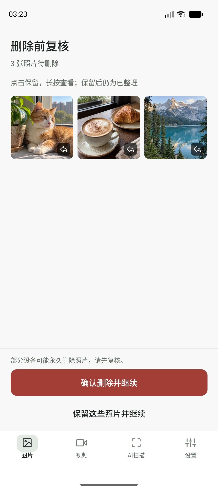
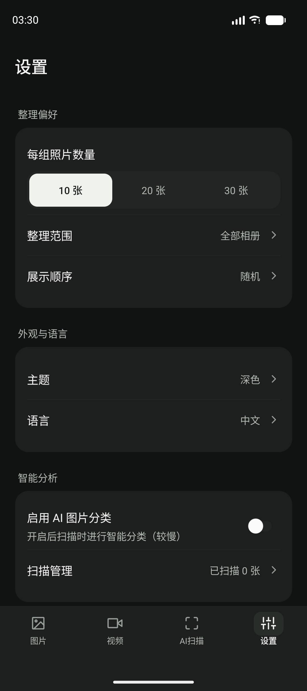

简体中文 | [English](README.en.md)

# PickPic

PickPic 是一款离线优先的本地照片与视频整理工具。逐张浏览，决定保留、跳过或加入待删除队列，在清理相册的同时在设备本地安全记录整理进度。支持浅色、深色与跟随系统主题，以及完全在设备端运行的模糊检测、相似照片对比与可选图像分类。

当前公开发布版本为 **0.4.0**，目前面向 Android，iOS 支持仍在完善中。

> **发布版与开发分支说明**：当前开发分支在 `0.4.0` 基础上新增了本机记录 AES-256-GCM 与 SQLCipher 加密、口令加密备份与恢复、统一待删除复核、可恢复整理会话与近期决定撤销、月份 / Android 大文件优先 / 截图与录屏相册筛选、跟随系统主题、相似照片联动对比、分页单事务批量扫描同步与 SDK 隐私日志脱敏补丁；这些改动尚未包含在下方 `0.4.0` 下载包中。更多设计说明见 [开发文档索引](docs/README.md) 与 [加密与 SDK 补丁说明](docs/ENCRYPTED_BACKUP.md)。

## 下载（0.4.0 发布版）

下载 [0.4.0 Android APK](https://github.com/1Beyond1/PickPic/releases/download/v0.4.0/PickPic-v0.4.0-arm64.apk)，或查看 [完整更新说明与校验文件](https://github.com/1Beyond1/PickPic/releases/tag/v0.4.0)。安装包支持 **Android 10 及以上、ARM64（arm64-v8a）**，内置运行资源，无需 Expo Go 或开发服务器。其他版本见 [GitHub Releases](https://github.com/1Beyond1/PickPic/releases)。

**旧版安装提醒**：`0.4.0` 起使用独立发布签名，与 `0.3.1` 的调试签名不同。旧版通常无法直接覆盖升级，需先卸载再安装；卸载会清除应用内整理、扫描及偏好记录，不会删除原照片或视频。如需保留旧版待删除决定，请先自行记录；重装不会迁移队列或替你执行删除。

## 界面预览

<p align="center">
  <a href="assets/screenshots/photo-home.jpg"></a>
  &nbsp;&nbsp;
  <a href="assets/screenshots/photo-organizer.jpg"></a>
</p>

<p align="center">
  <a href="assets/screenshots/photo-review.jpg"></a>
  &nbsp;&nbsp;
  <a href="assets/screenshots/settings-dark.jpg"></a>
</p>

## 核心功能

### 照片与视频整理

- **照片卡片整理**：按批次（10 / 20 / 30 张）逐张整理；上滑加入待删除列表，下滑保留，操作本身不会立即删除原照片。
- **视频流式整理**：上下滑动浏览，侧边提供静音、收藏、分享、保留与加入待删除操作；仅打开或离开视频页不会误记为已整理，支持回看已整理视频与长按全屏。
- **可恢复会话、跳过与近期决定（开发分支）**：照片与视频会话支持重启后继续原范围与进度；支持「暂时跳过」供后续回访，并在本机保留最多 100 条近期决定支持撤销。
- **多维度整理范围（开发分支）**：支持按相册、自然月份、最新 / 最早 / 随机顺序筛选；Android 上通过自有原生模块 `PickPicMediaIndex` 读取 `MediaStore` 大小字段提供「大文件优先」排序，并支持截图 / 录屏相册快捷筛选。
- **统一待删除复核（开发分支）**：照片、视频及设备端分析结果页均统一汇总至待删除复核界面，按类型/来源筛选；点击缩略图预览，使用独立的「改为保留」操作撤回待删除并保持已整理状态，经确认后才请求系统删除。（注：已发布的 `0.4.0` 仍使用组末复核与独立入口。）

### 设备端分析与相似照片对比

- **完全本地运行**：模糊检测（拉普拉斯方差 / 亮度均值）、感知哈希（64-bit dHash）与时间窗口相似照片分组均在设备本地计算，不向云端 AI 服务上传媒体，也不会触发自动删除。
- **分页批量同步（开发分支）**：图库索引同步按页（每页 100 张）批量读取并跳过已有效且未变动的资产文件检查，受控并发（上限 16）查询新增或变更项，并以单次 SQLCipher 事务提交整页变更，同时响应中途暂停/停止并安全续扫；大图人脸检测前自动缩放并及时清理临时文件。
- **相似照片并排与 A/B 对比（开发分支）**：支持并排与 A/B 视图、联动缩放与参数查看；先明确保留一张或多张，再将其余选中项加入待删除并完成本组，推荐保留综合参考分辨率、清晰度与亮度评分。
- **可选图片分类与人物检测**：默认关闭，可在「设置 → 智能分析」开启。分类使用随包 `EfficientNet-Lite4`（TFLite），人物检测使用 ML Kit（高分辨率原图先缩放再检测）。开发分支支持在「扫描管理」中按需补扫缺失分类或重试失败项，保留已有清晰度与相似组结果；开启开关不会自动启动扫描。

### 本地加密、口令备份与隐私保护（开发分支）

- **本机加密存储与失败关闭（Fail-Closed）**：整理记录、待删除/收藏队列、会话与设置使用本机 AES-256-GCM 认证加密；扫描索引数据库使用 SQLCipher 加密；各域随机设备密钥由 `expo-secure-store`（Android Keystore / iOS Keychain）托管。若密钥缺失、密文认证失败或存储读写出错，应用进入隐私保护门禁，不会用默认空记录覆盖已有密文。
- **口令加密备份与恢复（v1）**：可在「设置 → 数据管理」导出/恢复整理决定、收藏与待删除队列（不含原照片/视频、缩略图、EXIF 或位置）。使用 `react-native-quick-crypto` 原生异步 `scrypt`（`N=65536, r=8, p=2`）派生密钥与 AES-256-GCM 认证加密，支持导入前预览与冲突保护。
- **缓存与系统备份边界**：不申请位置权限（`isAccessMediaLocationEnabled: false`）；相册预览使用内存缓存，启动与扫描阶段清理自有临时图片并在清理失败时触发隐私门禁；Android/iOS 配置插件排除应用私有数据的系统自动备份。
- **SDK 隐私日志脱敏补丁**：通过 `scripts/apply-privacy-patches.js` 对 ML Kit 与 `expo-media-library` 共 12 个文件进行受版本与 SHA-256 指纹校验的日志脱敏，并在 Android 上强制 `expo-media-library` 与 `expo-image` 从源码构建以防预编译库绕过补丁。

更多加密与备份设计说明见 [ENCRYPTED_BACKUP.md](docs/ENCRYPTED_BACKUP.md)。

## 删除与云同步风险提示

**请先备份重要照片和视频。** PickPic 的待删除列表只是系统确认前的本地队列，不是用于恢复已删除文件的系统回收站。

- 当前删除接口不保证媒体进入系统回收站。Android 11 及以上使用 `MediaStore.createDeleteRequest`，请求的是直接永久删除而非移入回收站，参见 [Android 官方文档](https://developer.android.com/training/data-storage/shared/media#manage-groups-media-files)。
- Android 16 及以上的大批量删除会按每批最多 2,000 项分批请求系统确认；成功批次即时记账，后续取消或失败时保留未完成项在待删除队列中。
- PickPic 不管理云端相册，也无法保证「只删本地、云端保留」。开启 iCloud 照片或其他云同步服务时，删除决定可能同步至云端与其他设备，参见 [Apple 官方说明](https://support.apple.com/en-nz/104967)。

## 技术架构

- **框架与 UI**：React Native `0.81.5`（New Architecture + React Compiler）、Expo SDK `54`、TypeScript `~5.9`、Expo Router `~6.0`、Zustand `^5.0`、Reanimated `~4.1`、Gesture Handler、expo-media-library、expo-video、expo-image。
- **本地安全与加密**：`expo-sqlite`（SQLCipher）、`expo-secure-store`、`@noble/ciphers`、`@noble/hashes`、`react-native-quick-crypto`（Nitro 原生异步 scrypt）。
- **设备端图像与 ML**：`@infinitered/react-native-mlkit-core` / `image-labeling` / `face-detection`（`5.0.0`）、随包 `assets/ml/efficientnet-lite4.tflite`、`expo-image-manipulator`、`jpeg-js`。
- **自有原生模块与插件**：
  - `modules/pickpic-media-index`：Android Kotlin 只读 `MediaStore` 大小批量查询模块（单批 ≤ 200）。
  - `modules/pickpic-system-ui`：Android Kotlin 弹窗状态栏/导航栏明暗外观原地同步模块。
  - `plugins/withNativeCryptoToolchain.js` & `plugins/withPrivateRecordsBackup.js`：原生加密工具链对齐与系统备份排除配置插件。

## 从源码运行与验证

### 环境要求

- Node.js `20.19.4+` 与 npm（CI 与完整自动化测试使用 **Node.js `24.11.1`**）。
- Android 本地开发：JDK 17、Android SDK，以及模拟器或真机。
- iOS 本地开发：macOS 与 Xcode。

```bash
git clone https://github.com/1Beyond1/PickPic.git
cd PickPic
npm ci

# 首次构建并安装 Android 开发客户端
npm run android

# 后续启动开发服务器，连接已安装的开发客户端
npx expo start --dev-client
```

项目包含 ML Kit、SQLCipher、Quick Crypto 与自有 Kotlin 原生模块，不能仅使用 Expo Go 运行完整应用；改动原生依赖后需重新构建开发客户端。详见 [Expo 开发构建说明](https://docs.expo.dev/workflow/customizing/)。

`npm ci` 会自动通过 `postinstall` 运行 `scripts/apply-privacy-patches.js`。若环境禁用了 npm 生命周期脚本，构建前必须显式执行补丁并通过 `--check` 校验，不可跳过。

### 自动化检查与构建

```bash
# 与 CI (.github/workflows/ci.yml) 一致的四项必过校验
node scripts/apply-privacy-patches.js --check
npm run typecheck
npm run lint
npm run test:ci

# EAS 云端预览 APK（需 Expo 账号与项目权限）
npx eas-cli build -p android --profile preview

# macOS / Linux 本地 EAS 预览 APK（Windows 原生不支持 EAS --local）
npx eas-cli build -p android --profile preview --local
```

### 自动化测试覆盖

当前开发分支包含 **94 套测试 / 929 项测试用例**（覆盖内存 SQLite 事务、AES-256-GCM / `scrypt` 加密、Zustand 恢复与隐私门禁、扫描批处理与并发上限、SDK 隐私补丁指纹校验等），并与 TypeScript、ESLint 及补丁检查一起纳入 CI 门禁。真机测试项目见 [REAL_DEVICE_CHECKLIST.md](docs/REAL_DEVICE_CHECKLIST.md)。

## 反馈与贡献

- 协作者请先阅读 [AGENTS.md](AGENTS.md) 与 [docs/README.md](docs/README.md)。
- 通过 [Issues](https://github.com/1Beyond1/PickPic/issues) 反馈问题时，请提供应用版本、设备型号、系统版本与复现步骤。
- 提交代码前请确保上述四项检查全部通过，避免提交签名密钥、`build-artifacts/`、`*.pickpic` 等本地或敏感文件。

## 许可证

项目原创代码采用 [Apache License 2.0](LICENSE)，署名信息见 [NOTICE](NOTICE)。第三方依赖与预训练模型保留各自许可证。
